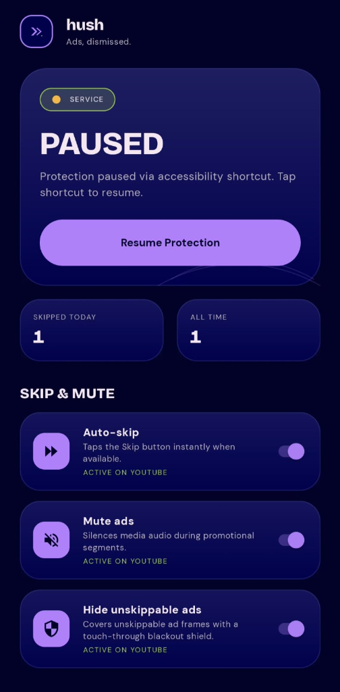
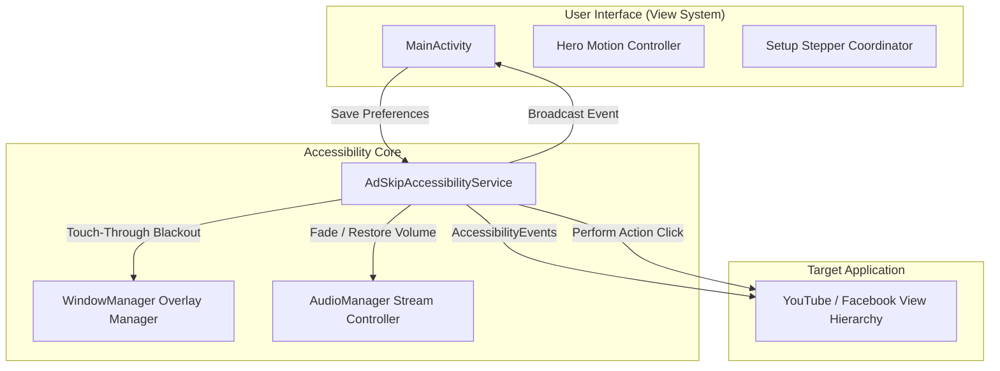

<div align="center">

  

  <p align="center">
    <a href="#how-it-works"><b>How It Works</b></a> •
    <a href="#key-features"><b>Features</b></a> •
    <a href="#visual-identity--motion"><b>Design System</b></a> •
    <a href="#architecture"><b>Architecture</b></a> •
    <a href="#setup-guide-android-13"><b>Setup Guide</b></a> •
    <a href="#installation"><b>Download</b></a>
  </p>

  <p align="center">
    
    
    
    
    
  </p>

  

</div>

---

<div align="center">
  <table border="0">
    <tr>
      <td width="55%" valign="middle">
        <h2>✨ Experience Silence in Streaming</h2>
        <p><b>Hush</b> is an edge-to-edge Android utility crafted for seamless media playback. It runs completely on-device using official Android Accessibility APIs to detect promotional segments, mute audio during adverts, and tap skip buttons the millisecond they appear.</p>
        <p>No account logins. No network tracking. No APK tampering. Just pure uninterrupted streaming.</p>
        <p>
          
          
          
        </p>
      </td>
      <td width="45%" align="center" valign="middle">
        
      </td>
    </tr>
  </table>
</div>

---

## 🔍 How It Works

Hush leverages the standard Android Accessibility framework to observe app layout updates without modifying or intercepting app packages:

```
                      ┌─────────────────────────────────┐
                      │   User Watching YouTube Video   │
                      └────────────────┬────────────────┘
                                       │
                      [Accessibility Window State Change]
                                       │
                                       ▼
                      ┌─────────────────────────────────┐
                      │  AdSkipAccessibilityService     │
                      │  Detects Ad Nodes in Hierarchy  │
                      └────────┬───────────────┬────────┘
                               │               │
                 If Ad Playing │               │ Skip Button Ready
                               ▼               ▼
                 ┌───────────────────┐   ┌──────────────────────┐
                 │ 🔇 Mute Stream    │   │ ⏩ Perform Node Click│
                 │ 🛡️ Show Shield    │   │ 🔊 Restore Volume    │
                 └───────────────────┘   └──────────────────────┘
```

1. **Passive Event Listening**:
   When YouTube changes views, Android dispatches an `AccessibilityEvent.TYPE_WINDOW_CONTENT_CHANGED`. Hush only wakes up when the event originates from the target media package (`com.google.android.youtube`).

2. **Sub-second Affordance Detection**:
   Hush scans the node hierarchy for resource IDs and view texts representing ad countdowns and skip actions (such as `skip_ad_button` or `modern_skip_ad_button`).

3. **Atomic Execution**:
   - **Auto-Skip**: As soon as the button turns clickable, an atomic `ACTION_CLICK` action is dispatched to dismiss the ad.
   - **Media Mute**: While an ad node is detected, Hush mutes `AudioManager.STREAM_MUSIC` without altering your ringer or notification levels, and restores it the instant normal video playback resumes.
   - **Touch-Through Ad Shield**: For unskippable ads, an opaque touch-through window overlay (`TYPE_ACCESSIBILITY_OVERLAY`) dims out intrusive visuals while allowing your normal touch gestures to pass through unhindered.

---

## 🚀 Key Features

```
┌─────────────────────────────────────────────────────────────────┐
│                           HUSH CORE                             │
├───────────────────────────────┬─────────────────────────────────┤
│  ⏩ Auto-Skip Segment         │  🔇 Smart Media Mute            │
│  Taps skip buttons in 200ms   │  Mutes promo streams instantly  │
├───────────────────────────────┼─────────────────────────────────┤
│  🛡️ Touch-Through Blackout    │  📱 Facebook Sponsored Shield   │
│  Masks non-skippable video    │  Experimental story filter      │
├───────────────────────────────┼─────────────────────────────────┤
│  📊 Tabular Live Stats        │  🔑 Android 13+ Setup Flow      │
│  Track ads dismissed today    │  Guided restricted settings UX  │
└───────────────────────────────┴─────────────────────────────────┘
```

- **Smart Auto-Skip**: Taps the Skip button within milliseconds of availability.
- **Instant Media Mute**: Mutes volume on promotions and safely restores your exact volume afterward.
- **Blackout Ad Shield**: Overlays an opaque touch-through barrier across unskippable ad frames.
- **Facebook Feed Shield (Experimental)**: Detects and filters sponsored posts across your Facebook feed.
- **Floating Accessibility Quick-Pause**: Tap the system accessibility button anytime to pause or resume Hush without opening the app.
- **Live Tabular Metrics**: Tracks ads dismissed today and of all time using tabular figures to eliminate text layout jumps.

---

## 💎 Visual Identity & Motion

Hush follows a high-contrast dark theme engineered to look and feel like a modern Android app:

<div align="center">
<table>
  <tr>
    <td align="center" width="16.6%"><br/><b>Midnight</b><br/><code>#03012A</code><br/><i>Canvas Base</i></td>
    <td align="center" width="16.6%"><br/><b>Ultramarine</b><br/><code>#01004D</code><br/><i>Cards & Depth</i></td>
    <td align="center" width="16.6%"><br/><b>Violet</b><br/><code>#AF80FA</code><br/><i>Active Hero</i></td>
    <td align="center" width="16.6%"><br/><b>Blush</b><br/><code>#F4E7F1</code><br/><i>Primary Text</i></td>
    <td align="center" width="16.6%"><br/><b>Lime</b><br/><code>#95C34D</code><br/><i>Pulse Spark</i></td>
    <td align="center" width="16.6%"><br/><b>Hairline</b><br/><code>#1A1966</code><br/><i>Dividers</i></td>
  </tr>
</table>
</div>

### 🎨 WCAG AAA Contrast Matrix
All interactive typography passes rigorous accessibility standards:
- **Violet on Midnight**: `7.00:1` (WCAG AAA)
- **Blush on Midnight**: `16.85:1` (WCAG AAA)
- **Lime on Midnight**: `9.78:1` (WCAG AAA)
- **Blush 70% on Ultramarine**: `8.77:1` (WCAG AAA)

### 🌊 Motion Choreography
- **Concentric Pulse Glow**: Dual radar-style pulse rings that animate continuously behind the live status indicator when active.
- **Hero State Transitions**: Color-interpolated state transitions across OFFLINE, ACTIVE (Solid Violet), and PAUSED states.
- **Micro-haptics & Elevation**: Cards and switch tiles subtly compress and release (`0.92x` → `1.0x`) alongside clock-tick haptics.
- **Accessible Motion**: Seamlessly reads system `ANIMATOR_DURATION_SCALE` and collapses animations when "Reduce Motion" is enabled.

---

## 🛠️ Architecture



---

## 📱 Setup Guide (Android 13+)

Sideloaded APKs on Android 13, 14, 15, and 16 place accessibility permissions under "Restricted settings". Hush includes an interactive stepper to guide you:

1. **Step 1**: Open **Accessibility settings** ➔ Tap **Hush Service** ➔ Press **OK** on the restricted prompt.
2. **Step 2**: Open **App Info** ➔ Tap the top-right **three dots (⋮)** ➔ Tap **"Allow restricted settings"** (Authenticate with PIN or Fingerprint).
3. **Step 3**: Return to **Hush** and switch the service **ON**.

#### 💡 Terminal ADB Shortcut (Optional):
```bash
adb shell appops set com.njk.adskipper ACCESS_RESTRICTED_SETTINGS allow
```

---

## 📦 Installation

### Pre-built Release
Download the signed release APK from GitHub Releases:
- **Download**: [`app-release.apk`](https://github.com/itsniranjannn/YtAdskipper/releases/latest)
- **Signature**: Verified via APK Signature Scheme v2

### Compile From Source
```bash
# 1. Clone repository
git clone https://github.com/itsniranjannn/YtAdskipper.git
cd YtAdskipper

# 2. Build debug APK
./gradlew assembleDebug

# 3. Build release APK
./gradlew assembleRelease
```

---

## 🛡️ Privacy & Permissions

- **No Network Permission**: Hush does not request or possess `android.permission.INTERNET`. Zero data leaves your device.
- **On-Device Processing**: Layout evaluations happen in real-time in volatile memory; nothing is logged to disk.
- **Disclaimer**: Hush is an independent open-source utility for personal accessibility. It is not affiliated with, endorsed by, or sponsored by YouTube, Meta, or Google LLC.

---

## 📄 License

This project is licensed under the [MIT License](LICENSE).
