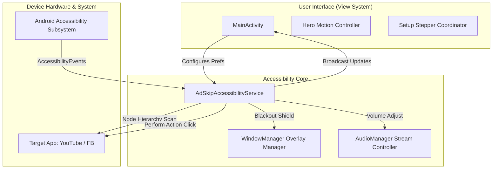

<div align="center">

  

  <p align="center">
    <a href="#key-features"><b>Features</b></a> •
    <a href="#visual-identity--motion"><b>Design System</b></a> •
    <a href="#architecture"><b>Architecture</b></a> •
    <a href="#setup-flow-android-13"><b>Setup Guide</b></a> •
    <a href="#build--installation"><b>Download APK</b></a>
  </p>

  <p align="center">
    
    
    
    
    
  </p>

  

</div>

---

## ⚡ What is Hush?

**Hush** is a lightweight, edge-to-edge Android utility crafted for pure peace of mind. Built with Google's Material Components, custom physics-driven spring animations, and strict zero-battery-drain accessibility checks, Hush continuously runs silently on your device to keep your streaming uninterrupted.

> *"Turn the volume down on the noise, and turn up what matters."*

---

## 💎 Visual Identity & Motion

Hush features a tailored, high-contrast dark palette designed to stand out against standard material templates.

<div align="center">
<table>
  <tr>
    <td align="center" width="16.6%"><br/><b>Midnight</b><br/><code>#03012A</code><br/><i>Canvas</i></td>
    <td align="center" width="16.6%"><br/><b>Ultramarine</b><br/><code>#01004D</code><br/><i>Cards & Depth</i></td>
    <td align="center" width="16.6%"><br/><b>Violet</b><br/><code>#AF80FA</code><br/><i>Active Hero</i></td>
    <td align="center" width="16.6%"><br/><b>Blush</b><br/><code>#F4E7F1</code><br/><i>Primary Text</i></td>
    <td align="center" width="16.6%"><br/><b>Lime</b><br/><code>#95C34D</code><br/><i>Pulse Spark</i></td>
    <td align="center" width="16.6%"><br/><b>Hairline</b><br/><code>#1A1966</code><br/><i>Dividers</i></td>
  </tr>
</table>
</div>

### 🎨 WCAG AAA Contrast Matrix
All interactive and readable typography strictly passes **WCAG AAA** standards:
- **Violet vs Midnight**: `7.00:1` (AAA)
- **Blush vs Midnight**: `16.85:1` (AAA)
- **Lime vs Midnight**: `9.78:1` (AAA)
- **Blush 70% vs Ultramarine**: `8.77:1` (AAA)

### 🌊 Motion Choreography
- **Concentric Pulse Glow**: Dual radar-style pulse rings animating indefinitely behind the live status indicator when active.
- **Hero State Morphing**: Color shifts via `ArgbEvaluator` between OFFLINE, ACTIVE (Solid Violet), and PAUSED states.
- **Micro-haptics & Elastic Elevation**: Cards and switch tiles subtly scale (`0.92x` → `1.0x`) with `FastOutSlowInInterpolator` alongside clock-tick haptic feedback.
- **Accessibility Friendly**: Reads system `ANIMATOR_DURATION_SCALE`; transitions cleanly collapse to instantaneous state shifts when "Reduce Motion" is toggled in device settings.

---

## 🚀 Key Features

```
┌─────────────────────────────────────────────────────────────────┐
│                           HUSH CORE                             │
├───────────────────────────────┬─────────────────────────────────┤
│  ⏩ Auto-Skip Segment         │  🔇 Smart Media Mute            │
│  Taps skip buttons in 200ms   │  Mutes promo streams instantly  │
├───────────────────────────────┼─────────────────────────────────┤
│  🛡️ Touch-Through Blackout    │  📱 Facebook Sponsored Shield   │
│  Masks non-skippable video    │  Experimental story filter      │
├───────────────────────────────┼─────────────────────────────────┤
│  📊 Tabular Live Stats        │  🔑 Android 13+ Setup Flow      │
│  Track ads dismissed today    │  Guided restricted settings UX  │
└───────────────────────────────┴─────────────────────────────────┘
```

1. **Auto-Skip**: Actively checks `com.google.android.youtube` node hierarchies for Skip ad affordances (`id/skip_ad_button`, `id/modern_skip_ad_button`) and executes atomic clicks.
2. **Instant Media Mute**: Intercepts ad banners and mutes `AudioManager.STREAM_MUSIC`, gracefully fading volume back upon return to the user's video.
3. **Blackout Ad Shield**: Mounts an edge-to-edge window (`TYPE_ACCESSIBILITY_OVERLAY`) with `FLAG_NOT_TOUCHABLE` and `FLAG_NOT_FOCUSABLE` to dim out intrusive video ads without disrupting touch gestures.
4. **Adaptive Stats**: Displays saved counts with monospace tabular numbers to eliminate jitter during counter increments.
5. **Experimental FB Filter**: Highlights and blocks sponsored feed narratives directly in the Facebook timeline.

---

## 🛠️ Architecture

Hush is designed with zero external bulk, operating natively on standard Android framework APIs:



- **Zero Third-Party Trackers**: No analytics, no remote telemetry, no external SDKs.
- **Battery Preservation**: Triggers solely on accessibility window state transitions; stays in deep sleep when the screen is off or when YouTube is not focused.

---

## 📱 Setup Flow (Android 13+)

Sideloaded apps on Android 13, 14, 15, and 16 are restricted by default from accessing Accessibility services. Hush includes an integrated first-run stepper:

1. **Open Accessibility Settings** ➔ Select **Hush Service** ➔ Tap **OK** on the restriction prompt.
2. **Open App Info** ➔ Tap the top-right **three dots (⋮)** ➔ Tap **"Allow restricted settings"** (Authenticate via PIN/Fingerprint).
3. **Return to Hush** ➔ Toggle service **ON**.

#### 💡 Power-User ADB Shortcut:
If you prefer setting it up via your terminal:
```bash
adb shell appops set com.njk.adskipper ACCESS_RESTRICTED_SETTINGS allow
```

---

## 📦 Build & Installation

### Option 1: Direct APK Download
Grab the pre-signed release APK directly from the repo:
- **Signed APK**: [`app/build/outputs/apk/release/app-release.apk`](app/build/outputs/apk/release/app-release.apk)
- **Signature Scheme**: APK Signature Scheme v2 (Signed with dedicated keystore)

### Option 2: Build From Source
Clone the repository and compile using the Gradle wrapper:

```bash
# 1. Clone the repository
git clone https://github.com/itsniranjannn/YtAdskipper.git
cd YtAdskipper

# 2. Build Debug APK
./gradlew assembleDebug

# 3. Build Signed Release APK (Supply environment variables if custom)
./gradlew assembleRelease
```

---

## 📄 License

This project is licensed under the [MIT License](LICENSE).

<div align="center">
  <sub>Crafted with passion for clean Android experiences.</sub>
</div>
